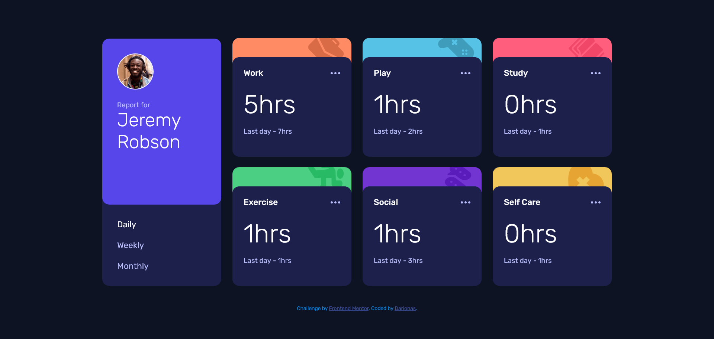

# Frontend Mentor - Time tracking dashboard solution

This is a solution to the [Time tracking dashboard challenge on Frontend Mentor](https://www.frontendmentor.io/challenges/time-tracking-dashboard-UIQ7167Jw). Frontend Mentor challenges help you improve your coding skills by building realistic projects. 

## Table of contents

- [Overview](#overview)
  - [The challenge](#the-challenge)
  - [Screenshot](#screenshot)
  - [Links](#links)
- [My process](#my-process)
  - [Built with](#built-with)
  - [What I learned](#what-i-learned)
  - [Continued development](#continued-development)
  - [Useful resources](#useful-resources)
  - [AI Collaboration](#ai-collaboration)
- [Author](#author)
- [Acknowledgments](#acknowledgments)

## Overview

### The challenge

Users should be able to:

- View the optimal layout for the site depending on their device's screen size
- See hover states for all interactive elements on the page
- Switch between viewing Daily, Weekly, and Monthly stats

### Screenshot

### Links

- Solution URL: [time tracking dashboard solution URL here](https://github.com/Darionas/time-tracking-dashboard)
- Live Site URL: [time tracking dashboard site URL here](https://darionas.github.io/time-tracking-dashboard/)

## My process

### Built with

- Semantic HTML5 markup
- CSS custom properties
- Flexbox
- CSS Grid
- Mobile-first workflow
- JavaScript

But created with :heart:

### What I learned

This project helped me deepen my understanding of:
- Using `fetch()` to load JSON data and handling the response with `.then()` and `.catch()`
- Dynamically generating HTML with template literals and `innerHTML`
- Managing state (the current filter) and updating the UI when it changes
- Using `classList` to toggle active states on buttons

### Continued development

I am taking part in My learning path on Frontend mentor.

### Useful resources

- [How to use promises](https://developer.mozilla.org/en-US/docs/Learn_web_development/Extensions/Async_JS/Promises) - This article on promises by MDN uses fetch heavily in the examples and should provide a good overview of how to handle fetch requests in your projects.
- [Making network requests with JavaScript](https://developer.mozilla.org/en-US/docs/Learn_web_development/Core/Scripting/Network_requests) - This is an in-depth look at network requests and the problem they solve. There's a lot of information here, so start with the first couple of sections.
- [Working with JSON](https://developer.mozilla.org/en-US/docs/Learn_web_development/Core/Scripting/JSON) - This article by MDN explains JSON. It also has an example of fetching data with fetch and populating a webpage with the response.

### AI Collaboration

I used GitHub Copilot. Mostly I used for debugging and for brainstorming. It is very handy tool. It let me to writte shorter, cleaner code. 

## Author

- Frontend Mentor - [@Darionas](https://www.frontendmentor.io/profile/Darionas)
- GitHub - [Darionas](https://github.com/Darionas)

## Acknowledgments

- Thank you to all Frontend Mentor team for opportunity to try, practice, train yourself in different level challenges and gain invaluable experience.
- Thank you to all supporters to inspire me to keep improving and coding. 
